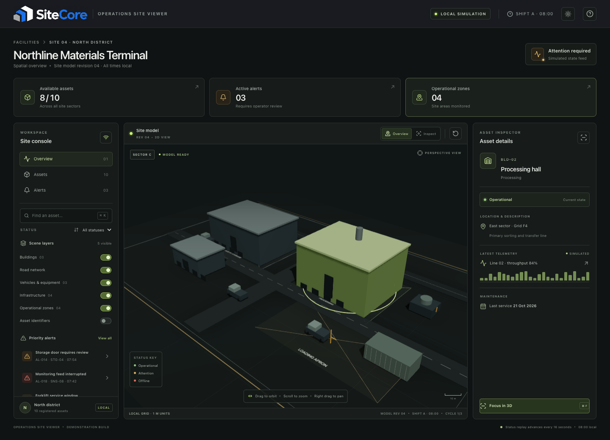
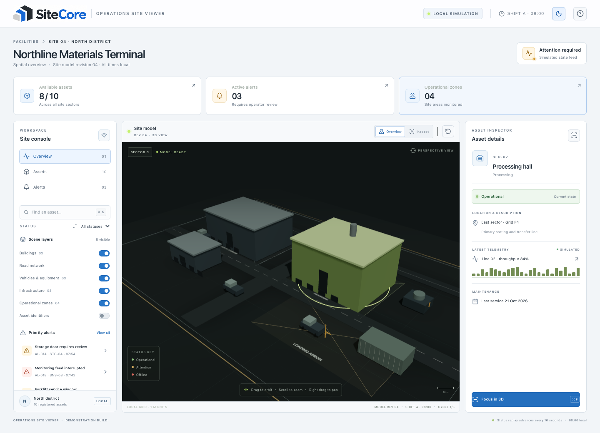

# SiteCore — Operations Site Viewer

A standalone React + TypeScript operations dashboard featuring a procedural 3D industrial site. The scene and UI use deterministic local mock data; there are no external maps, backend services, authentication, or API tokens. Use the theme control in the header to switch between light and dark dashboard themes; the matching SiteCore logo variant is displayed automatically and your preference is saved locally.

## Interface previews

**Dark theme**



**Light theme**



## Requirements

- Node.js 20.19+ (or 22.12+)
- npm
- A modern browser with WebGL enabled

## Run locally

```bash
cd ~/Documents/operations-site-viewer
npm install
npm run dev
```

Open the local URL printed by Vite (usually `http://localhost:5173`).

## Production build

```bash
npm run build
npm run preview
```

## Controls

- Drag the scene to orbit; right-drag or two-finger drag to pan; scroll or pinch to zoom.
- Select a building, vehicle, or infrastructure object in the scene or asset register to inspect it.
- Use **Focus in 3D** to smoothly center the camera on an asset.
- Switch between **Overview** and **Inspect** camera modes; **Reset camera** returns to the site overview.
- Search by asset name, ID, type, or location, then filter by status.
- Toggle scene layers in the left panel. The layer count and rendered model update together.
- Open an alert to select its related asset.
- `⌘/Ctrl + K` focuses asset search; `⌘/Ctrl + F` focuses the selected asset; `Escape` exits Inspect mode.
- The local replay cycles through fixed status snapshots every 16 seconds; it does not contact a live site.

## Project structure

```text
src/
├── components/
│   ├── AssetInspector.tsx
│   ├── MetricCard.tsx
│   └── SiteScene.tsx       # Scene geometry, selection, and camera controls
├── data/site-data.ts       # Local site, asset, alert, and replay fixtures
├── hooks/                  # Deterministic status replay
├── types/                  # Shared application types
├── App.tsx
├── App.css
├── index.css
└── main.tsx
```

The site geometry is assembled from reusable low-polygon primitives, so it can be reviewed and run without a model download or licensed third-party asset.

The supplied SiteCore light and dark logo variants are kept together in `public/sitecore-logo-variants.png`; the header clips the matching version for the active theme.
